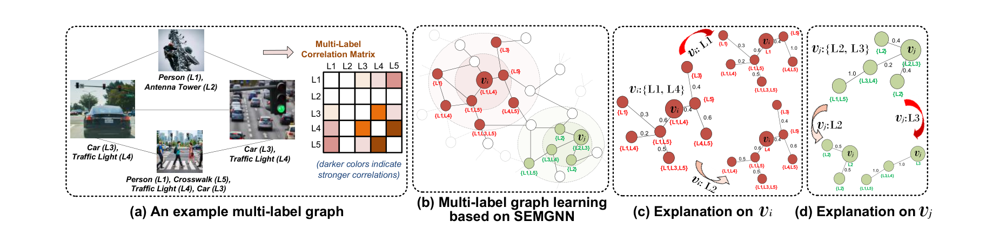
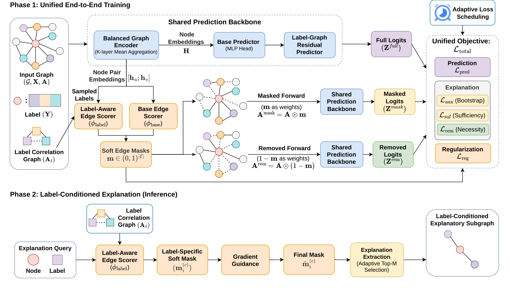
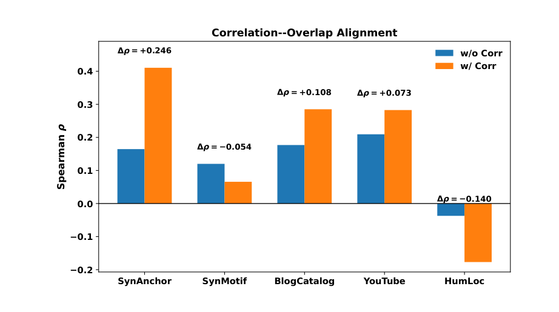

<div align="center">

# Self-Explainable Multi-Label Graph Neural Network<br>for Correlated Evidence Attribution

***ICDM 2026***

[](https://arxiv.org/abs/2608.27574)
[](#citation)
[](https://www.python.org/)
[](https://pytorch-geometric.readthedocs.io/)

[Quick Start](#quick-start) • [Datasets](#datasets) • [Results](#results) • [Citation](#citation)

> Official PyTorch implementation of **SEMGNN**, an end-to-end self-explainable multi-label GNN that jointly predicts node labels and identifies label-conditioned explanatory edges.

---

## Overview

In multi-label node classification, one node can carry several labels, and those labels are often correlated. Existing GNN explainers are mostly **post-hoc** and **single-label**: explaining each label independently misses evidence shared by related labels, while one explanation for all labels hides label-specific rationales.

We introduce **SEMGNN**, an end-to-end **self-explainable multi-label GNN** that jointly learns

- a multi-label node classifier, and
- a sparse, **label-conditioned edge-mask explainer**,

under a single sufficiency–necessity–sparsity objective. Label–label correlations are used on both sides: to sharpen prediction, and to let positively related labels **share** explanatory evidence while weakly or negatively associated labels keep **distinct** rationales.

<p align="center">
  
</p>

*Different labels of the same node may rely on distinct yet partially shared structural evidence.*

## Method

<p align="center">
  
</p>

*Phase 1 (training) jointly learns prediction and intrinsic edge masking with a shared backbone. Phase 2 (inference) answers a query (node, label) with a label-specific mask refined by gradient-based necessity scores.*

1. **Shared prediction backbone.** A balanced GraphSAGE-style mean encoder, an MLP head, and a gated **label-correlation residual** branch (label-GCN over a Jaccard label graph).
2. **Intrinsic edge masking.** A base edge scorer plus a **label-aware edge scorer** produce a soft mask `m ∈ (0,1)^|E|`, used in a *masked* pass (sufficiency) and a *removed* pass with `1 − m` (necessity). The mask is regularized to be sparse, near-binary and non-degenerate.
3. **Label-conditioned explanation.** For a query `(v_i, c)`, SEMGNN scores edges in the 2-hop computation subgraph, fuses the label-specific mask with gradient guidance, and extracts a compact subgraph via adaptive Top-M selection.

Training uses an adaptive three-stage loss schedule (bootstrap → alignment → necessity).

## Repository Structure

```text
SEMGNN/
├── README.md
├── requirements.txt
├── train_SEMGNN.py            # Main entry point: training + prediction / explanation evaluation
├── SEMGNN.py                  # Model (encoder, label-GCN head, edge scorers) and losses
│
├── data_process/
│   └── data_process.py        # Dataset loading (edges, features, labels, id mapping)
├── eval/
│   └── evaluate.py            # Fidelity+/Fidelity- and ground-truth (F1/IoU) evaluators
├── utils/
│   ├── utils.py               # Seeding, stratified multi-label split, graph helpers
│   ├── gt_registry.py         # Ground-truth explanation registry for synthetic data
│   ├── optimal_threshold.py   # Validation-based global threshold search
│   └── auto_tune.py           # Optuna hyperparameter search
├── data_gen/
│   ├── gen_synthetic_anchor.py  # Generates SynAnchor (multi-hop reachability evidence)
│   ├── gen_synthetic_motif.py   # Generates SynMotif (local motif evidence)
│   └── prepare_humloc.py        # Downloads and preprocesses HumLoc
├── dataset/                   # All five datasets, ready to use
│   ├── synthetic_anchor/
│   ├── synthetic_motif/
│   ├── blogcatalog/
│   ├── youtube/
│   └── humloc/
└── assets/                    # Figures used in this README
```

### Main execution path

```text
train_SEMGNN.py
    ├── data_process/data_process.py   (load graph, features, labels)
    ├── utils/                         (split, GT registry, threshold)
    ├── SEMGNN.py                      (model + losses)
    └── eval/evaluate.py               (prediction, fidelity, GT metrics)
```

## Quick Start

```bash
git clone https://github.com/yfeng77/SEMGNN.git
cd SEMGNN

# 1) Install PyTorch + PyG for your CUDA/CPU setup first:
#    https://pytorch.org/get-started/locally/
#    https://pytorch-geometric.readthedocs.io/en/latest/install/installation.html
# 2) Then the remaining dependencies
pip install -r requirements.txt

# 3) Train and evaluate on SynAnchor (data is already in ./dataset)
python train_SEMGNN.py --dataset synthetic_anchor --device cuda
```

Each run prints prediction metrics (Micro/Macro-F1, Micro/Macro-AUPRC), Fidelity+/Fidelity−/sparsity, and, on synthetic data, GT precision/recall/F1/IoU. It writes:

- `ckpts/<dataset>_explainable_*.pt` — trained model
- `eval_logs/<dataset>_explainable_*_unified_eval.json` — all metrics in one file

## Datasets

All five datasets are **included in this repository** under `./dataset/`, so no download is needed to reproduce the paper.

| Dataset | Type | Nodes | Edges | Feat. dim | Labels | GT explanations |
|---|---|---:|---:|---:|---:|:---:|
| `synthetic_anchor` | Synthetic (multi-hop reachability) | 3,000 | 9,476 | 16 | 30 | ✓ |
| `synthetic_motif` | Synthetic (label-specific motifs) | 3,000 | 29,849 | 16 | 30 | ✓ |
| `blogcatalog` | Social network (interest groups) | 10,312 | 667,966 | 8 | 39 | – |
| `youtube` | Social network (communities) | 22,693 | 192,722 | 3* | 47 | – |
| `humloc` | Protein–protein interaction (subcellular location) | 3,106 | 18,496 | 32 | 14 | – |

\* YouTube has no node attributes; light structural features (degree-based) are built automatically at load time.

Expected layout of a dataset folder:

```text
dataset/<name>/
├── A_coo.npz | edges.csv | edges.txt   # graph
├── X.npy | features.npy                # node features (optional; auto-built if missing)
├── Y.npy                               # multi-hot labels, shape (N, C)
├── id_mapping.csv                      # optional
└── expl_gt.npz                         # synthetic only: label-conditioned GT edge masks
```

### Regenerating the synthetic benchmarks

The synthetic graphs are produced by fixed rule-based generators that are independent of SEMGNN. With the default settings they regenerate the released graphs and labels exactly (features match up to floating-point rounding):

```bash
python data_gen/gen_synthetic_anchor.py --out_dir ./dataset/synthetic_anchor --seed 42
python data_gen/gen_synthetic_motif.py  --out_dir ./dataset/synthetic_motif  --seed 42
```

### Rebuilding HumLoc from the raw source

HumLoc is derived from the HumanGo data released with [MLGNC](https://github.com/Tianqi-py/MLGNC). To rebuild it:

```bash
python data_gen/prepare_humloc.py --out_dir ./dataset/humloc
```

### Ablations (Table IV, Fig. 5)

| Variant in paper | Flags |
|---|---|
| SEMGNN (full) | *(default)* |
| w/o Pred-L | `--no-use_label_gcn_pred` |
| w/o Expl-L | `--no-use_label_aware` |
| Base | `--no-use_label_gcn_pred --no-use_label_aware` |
| w/o Corr (Fig. 5) | `--no-label_use_correlation` |

```bash
python train_SEMGNN.py --dataset synthetic_anchor --no-use_label_gcn_pred --device cuda
```

### Other useful flags

```text
--data_dir PATH          # dataset folder (default: ./dataset/<dataset>)
--split_path PATH        # load a saved {"train","val","test"} split
--eval_nodes_path PATH   # fix the set of nodes used for explanation evaluation
--num_eval_nodes 100     # number of test nodes to explain
--k_hop 2                # computation-subgraph radius for explanations
--use_gradient           # gradient guidance during training
```

Run `python train_SEMGNN.py --help` for the full list.

### Hyperparameter tuning

Run from the repository root as a module:

```bash
python -m utils.auto_tune --datasets synthetic_anchor synthetic_motif --n_trials 40 --device cuda
```

## Results

**Prediction** (SEMGNN, mean ± std over 3 seeds; full comparison in Table II of the paper):

| Dataset | Micro-F1 | Macro-F1 | µAUPRC | M-AUPRC |
|---|---|---|---|---|
| SynAnchor | 0.915 ± 0.018 | 0.844 ± 0.043 | 0.946 ± 0.014 | 0.930 ± 0.024 |
| SynMotif | 0.903 ± 0.030 | 0.779 ± 0.053 | 0.900 ± 0.002 | 0.942 ± 0.004 |
| BlogCatalog | 0.404 ± 0.033 | 0.092 ± 0.010 | 0.367 ± 0.051 | 0.143 ± 0.025 |
| YouTube | 0.287 ± 0.023 | 0.232 ± 0.022 | 0.252 ± 0.023 | 0.255 ± 0.031 |
| HumLoc | 0.615 ± 0.041 | 0.177 ± 0.028 | 0.625 ± 0.043 | 0.318 ± 0.087 |

**Explanation** (SEMGNN; full comparison with GNNExplainer, PGExplainer, GSAT and a post-hoc variant in Table III):

| Dataset | Fid+ | Fid− | GT F1 | GT IoU |
|---|---|---|---|---|
| SynAnchor | 0.860 ± 0.023 | 0.383 ± 0.017 | 0.463 ± 0.007 | 0.337 ± 0.006 |
| SynMotif | 0.878 ± 0.071 | 0.157 ± 0.016 | 0.320 ± 0.009 | 0.193 ± 0.006 |
| BlogCatalog | 0.853 ± 0.013 | 0.144 ± 0.006 | – | – |
| YouTube | 0.924 ± 0.005 | 0.202 ± 0.005 | – | – |
| HumLoc | 0.962 ± 0.017 | 0.264 ± 0.055 | – | – |

SEMGNN achieves the best GT F1/IoU on both synthetic benchmarks and the best Fid+/Fid− on YouTube.

<p align="center">
  
</p>

*Enabling label correlation increases the alignment between label relatedness and explanation overlap on SynAnchor, BlogCatalog and YouTube; on HumLoc, whose labels are negatively correlated on average, SEMGNN keeps explanations more distinct instead of forcing overlap.*

## Citation

If you find this work useful, please cite:

```bibtex
@inproceedings{feng2026semgnn,
  title     = {Self-Explainable Multi-Label Graph Neural Network for Correlated Evidence Attribution},
  author    = {Feng, Yingqi and Tang, Yufei and Zhu, Xingquan},
  booktitle = {Proceedings of the IEEE International Conference on Data Mining (ICDM)},
  year      = {2026}
}
```

## Acknowledgements

This work was supported in part by the U.S. National Science Foundation under Grants Nos. IIS-2302786, IIS-2236579, and CMMI-2145571. The authors would like to thank Dr. Min Shi from the University of Louisiana at Lafayette for his support and comments on this research.

